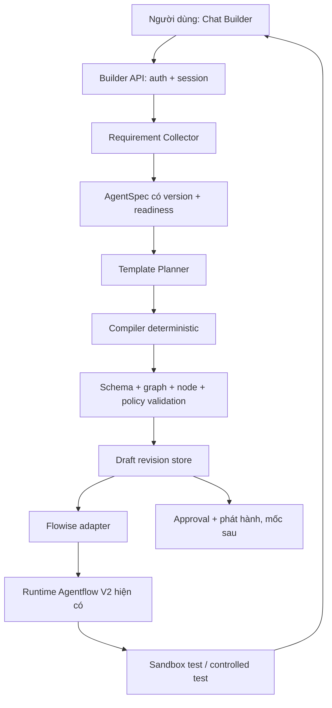

# Kế hoạch hệ thống Chat-to-Agent trên Flowise

**Bản 1.0 — 14/11/2026 — đề xuất để triển khai về sau.**
**Phiên hiện tại chỉ tạo kế hoạch, bộ nhớ chung và tiện ích harness cục bộ. Chưa viết UI/API/migration Builder.**

**Bảng phase và toàn bộ task con đã gom tại [PLAN_TONG_HOP.md](../../PLAN_TONG_HOP.md): 7 phase sản phẩm / 68 task con, thêm 8 task harness. Mở file đó trước khi cần giao việc; file này giải thích kiến trúc và lý do.**

## 1. Chốt đúng bài toán của sếp

> “Build agent từ A → Z bằng một giao diện chat. Quá trình build tự diễn ra khi bot nhận đủ thông tin.”

Sản phẩm cần là **Agent Builder có hội thoại**: người dùng mô tả mục đích, bot hỏi phần còn thiếu, hệ thống dựng Agent có thể chạy thử và chỉnh sửa tiếp. Flowise cung cấp runtime/node/credentials/canvas phía dưới. Chat là giao diện nghiệp vụ chính; canvas là công cụ kiểm tra dành cho developer.

Tài liệu V2 đi đúng hướng. Cần sửa thông tin phiên bản, giấy phép và giả định CodeGraph theo repo thực tế; xem [DOCUMENT_REVIEW.md](DOCUMENT_REVIEW.md). Không biến mọi đề xuất trong tài liệu đính kèm thành yêu cầu bắt buộc của phiên hiện tại.

**Demo đầu tiên nên chứng minh trọn một vòng**: “Tạo trợ lý hướng dẫn onboarding tiếng Việt” → bổ sung mục tiêu/đầu ra → tự tạo draft → chat thử → “đổi giọng văn thân thiện” → tạo revision mới. Sau đó thêm Knowledge Agent có nguồn kiểm soát. Không chờ hoàn thiện đồng thời SharePoint, SQL và API mới có demo.

## 2. Ba phần phải thiết kế độc lập

| Phần           | Người dùng                     | Đầu ra                                  | Tình trạng sau phiên này                |
| -------------- | ------------------------------ | --------------------------------------- | --------------------------------------- |
| Coding harness | Codex, Claude Code, Gemini CLI | Ngữ cảnh ngắn, handoff, kiểm tra, số đo | Bộ tiện ích local và tài liệu           |
| CodeGraph      | AI lập trình                   | Source/symbol/call path đúng phạm vi    | Đã truy xuất được; giữ kết nối hiện tại |
| Chat-to-Agent  | Người dùng nghiệp vụ           | Agent draft/test/revision               | Có kế hoạch; chưa triển khai            |

Harness không thay runtime, không điều khiển quota của nhà cung cấp. CodeGraph không phải connector cho Agent nghiệp vụ. Cả ba AI đọc một trạng thái chung, nhưng không cần chạy đồng thời trên một working tree.

## 3. Phạm vi theo mức ưu tiên

| Mốc               | Bao gồm                                                                                    | Chưa đưa vào mốc                                           |
| ----------------- | ------------------------------------------------------------------------------------------ | ---------------------------------------------------------- |
| Demo D1           | Chat đa lượt, spec cơ bản, một template assistant, draft, thử chat, một sửa đổi            | RAG connector thật, SQL, API bên ngoài, publish production |
| MVP M1            | Knowledge Agent trên bộ dữ liệu kiểm soát, citations, revisions/diff, lỗi rõ, auth hiện có | Tự sinh connector, code tùy ý, agent tự cấp quyền          |
| M2                | API chỉ đọc qua connector đã đăng ký; policy, eval và approval                             | Write tools không giới hạn                                 |
| M3                | SQL chỉ đọc qua executor có quyền và giới hạn; bổ sung integration theo nhu cầu            | SQL sinh tự do được tin là an toàn                         |
| Production nội bộ | Patch baseline, permission/license review, quan sát chi phí, rollback, runbook             | Public hosting trước khi đạt tiêu chí                      |

Mặc định draft/private. “Tự build khi đủ thông tin” không yêu cầu user xác nhận lại mọi bước nhỏ; chỉ thiếu dữ kiện bắt buộc mới hỏi. Việc kết nối credential và phát hành có tác động thực dùng thao tác có xác thực riêng.

## 4. Trải nghiệm người dùng

1. Người dùng mở “Tạo Agent bằng chat”, nhập mục tiêu bằng tiếng Việt.
2. Collector cập nhật các trường known/assumed/missing; hỏi 1–3 câu có giá trị nhất mỗi lượt.
3. Thẻ “Agent của bạn” hiển thị mục tiêu, đầu ra, nguồn dữ liệu, công cụ và phần còn thiếu. Không buộc người dùng biết node/graph.
4. Khi các trường build-blocking đủ, server tự chuyển sang build đúng revision. Không phụ thuộc model tự nói “đã đủ”.
5. Timeline hiển thị: Đang thiết kế → Đang tạo → Đang kiểm tra → Có thể thử. Không dùng phần trăm giả.
6. Draft thành công có panel chat thử và kết quả kiểm tra. Developer có thể mở `/v2/agentcanvas/:id` theo quyền.
7. Một yêu cầu chỉnh sửa tạo spec revision và draft revision mới; hiển thị thay đổi theo ngôn ngữ nghiệp vụ.
8. Refresh trang hoặc đổi phiên vẫn khôi phục session, revision và job đang chạy. Có hủy và retry rõ ràng.

Hai hội thoại phải tách biệt: **chat để xây Agent** và **chat với Agent vừa tạo**. UI thể hiện rõ đang ở chế độ nào, tránh gửi câu chỉnh cấu hình vào runtime chat.

## 5. Kiến trúc đích



V1 dùng **modular monolith trong repo hiện tại**. Backend Builder theo route → controller → service; dùng cùng auth context và DB conventions. Chưa cần microservice, monorepo thứ hai hoặc framework frontend thứ hai.

Compiler là ranh giới ổn định: model tạo spec/plan có schema; compiler ánh xạ vào template/node metadata của pinned runtime. Không để model toàn quyền sinh raw Flowise JSON và lưu thẳng.

Generator có sẵn được dùng làm spike/benchmark hoặc gợi ý plan; không làm nguồn duy nhất quyết định flow hợp lệ. Nó nạp nhiều marketplace templates vào prompt, có thể tốn context, và lỗi parse có thể được trả như object. Adapter phải chuẩn hóa lỗi.

## 6. Tái sử dụng và phần viết mới

| Hạng mục                             | Hướng xử lý                       | Lý do                                                        |
| ------------------------------------ | --------------------------------- | ------------------------------------------------------------ |
| UI React/MUI/layout/auth client      | Tái sử dụng                       | Đã có routing, refresh session, component library            |
| Canvas V2                            | Giữ làm developer view            | Kiểm tra flow thật, không phải dựng editor mới               |
| Chat UX hiện có                      | Khảo sát và chọn phần dùng lại    | Runtime chat chưa chắc có mô hình trạng thái phù hợp Builder |
| Express/TypeORM/runtime              | Giữ nền                           | Tránh viết execution engine mới                              |
| Node model/tool/retriever            | Dùng allowlist + metadata version | Chỉ hỗ trợ những node đã có fixture/test                     |
| Generator hiện có                    | Spike có đo chi phí/chất lượng    | Không mặc định đã hỗ trợ multi-turn/spec/history             |
| Session/collector/readiness          | Viết mới                          | Đây là logic quyết định khi nào tự build                     |
| Compiler/revision/test orchestration | Viết mới theo module              | Bảo đảm kết quả tái hiện được, chỉnh sửa an toàn             |
| Publish gate                         | Module mới sau demo               | Không suy diễn cờ deployed là lớp cách ly                    |

Đường dẫn **dự kiến, chưa tạo source folder trong phiên này**:

```text
packages/ui/src/views/agent-builder/           Chat page + summary + progress + test panel
packages/ui/src/api/agent-builder.js          Client theo convention hiện tại
packages/server/src/routes/agent-builder/     Router mount /api/v1/agent-builder
packages/server/src/controllers/agent-builder/
packages/server/src/services/agent-builder/   Collector, readiness, planner, compiler, adapter
packages/server/src/database/entities/       Builder entities khi đã duyệt storage design
```

Chưa thêm workspace package. Nếu compiler cần dùng ngoài server, ra ADR riêng trước khi tách package.

## 7. “Đủ thông tin” và lifecycle

Build readiness là hàm xác định từ spec hợp lệ + quyền/capabilities + template. Ví dụ assistant cơ bản cần name/goal/language/output expectations/model profile; Knowledge Agent thêm nguồn dữ liệu và yêu cầu citation. Model profile mặc định từ server có thể giảm câu hỏi.

Phân biệt `specReady`, `buildReady` và `testReady`: thiếu connector có thể vẫn lưu thiết kế nhưng không chạy thử dữ liệu. Không giả vờ agent hoạt động khi chưa có quyền/credential.

```text
DISCOVERING ↔ NEEDS_INPUT
      ↓ buildReady
PLANNING → COMPILING → VALIDATING → DRAFT_READY → TESTING → TESTED
                 ↘ FAILED (giữ diagnostics, cho phép sửa)
DRAFT_READY/TESTED → EDITING → spec revision mới → build lại
TESTED → APPROVAL_PENDING → PUBLISHED (giai đoạn sau)
Job bất kỳ → CANCEL_REQUESTED → CANCELLED / TIMEOUT
```

Transitions chạy trên server, ghi event và revision. `clientMessageId` chống gửi trùng; `buildKey = session + specRevision + compilerVersion + templateVersion` chống tạo nhiều draft. Sửa spec trong lúc build phải hủy/đánh dấu superseded job cũ, không để kết quả cũ ghi đè bản mới.

Failure của auth/credential/policy không đưa vào repair tự động. Graph/parameter lỗi deterministic sửa bằng compiler. Quality repair tối đa 2 lượt mặc định, có hạn token/thời gian theo cấu hình; giới hạn được enforce trong backend ở giai đoạn triển khai.

## 8. Dữ liệu, API và background jobs

Chi tiết trong [CONTRACTS.md](CONTRACTS.md). Các bảng mới dự kiến: BuilderSession, BuilderMessage, AgentSpecRevision, AgentDraftRevision, BuildJob, BuilderEvent; approval/eval entities thêm khi đến mốc tương ứng.

-   Tenant/workspace/actor đến từ auth context; mọi repository query có scope phù hợp.
-   Spec và draft revision immutable; chat chỉnh sửa sinh revision mới.
-   Tạo draft là side effect có idempotency; persist mapping flowId/revision/job.
-   V1 dùng hạ tầng job hiện có nếu đáp ứng cancel/retry; tránh dựng queue thứ hai. Dùng DB-backed job record dù chạy inline ở spike để refresh không mất tiến độ.
-   SSE có eventId tăng dần, reconnect theo last event; reconnect không khởi tạo build mới. Khi history hết retention, client fetch snapshot.
-   Spec lưu logical model/connection references; server resolve theo actor quyền hạn, không gửi raw key cho browser/LLM.
-   Cần migration theo DB engines mà fork thực sự hỗ trợ; demo local không đồng nghĩa migration production hoàn tất.

## 9. Tối ưu token ở cả coding và sản phẩm

**Coding harness có trong bộ file này:** root instructions ngắn; state/map/task pack giới hạn ký tự; CodeGraph trước khi tìm code; checkpoint chung có Git SHA/revision; log slice; usage thật nhập từ client. Không tự gọi model/CodeGraph và không đọc source hàng loạt.

**Builder runtime — kế hoạch về sau:** gửi current spec + các câu chưa rõ + vài lượt gần nhất; chỉ lấy template/node metadata cần dùng; cache metadata theo runtime/template version; incremental spec patch; compiler deterministic không dùng LLM; không để model tự review toàn bộ lịch sử mỗi vòng. Mỗi request lưu model/version/usage/latency/repair reason theo chính sách dữ liệu.

Giảm số lần hỏi trùng và số lần build thất bại thường có giá trị hơn chỉ rút prompt. Bắt đầu một provider/model profile do đội chọn sau benchmark; không cố định model đắt hoặc giá theo suy đoán.

Chưa có số liệu tiết kiệm. Mục tiêu thử nghiệm: tối thiểu 5 task coding đại diện, mỗi task hai biến thể cùng model/snapshot/acceptance; đổi thứ tự chạy và lặp khi có điều kiện. So sánh token thực trên task đạt nghiệm thu cùng success rate, rework, latency. Không có usage thật thì báo unknown, chỉ dùng số ký tự như proxy.

## 10. Lộ trình và mốc nghiệm thu

Ước lượng dưới đây cho **một developer chính**, khoảng ngày làm việc tập trung; chưa gồm thời gian chờ credential/quyết định và chưa cam kết deadline. Chỉ hiệu chỉnh sau TASK-001. Có thể dùng AI để hỗ trợ nhưng không nhân ba năng suất mặc định.

| Phase             | Khoảng tham khảo | Đầu ra kiểm chứng                                                               | Điều kiện qua mốc                                                                |
| ----------------- | ---------------- | ------------------------------------------------------------------------------- | -------------------------------------------------------------------------------- |
| P0 Baseline       | 2–4 ngày         | Node/pnpm đúng engine; Flowise chạy local; fixture; auth/runtime map; chọn demo | Build/start có log; export 1 flow thật; test adapter smoke kế hoạch rõ           |
| P1 Conversation   | 3–5 ngày         | Chat/session/collector/readiness cho assistant cơ bản                           | Refresh còn state; không hỏi trùng; từ dữ kiện đủ tự dispatch 1 build với mock   |
| P2 Draft compiler | 4–6 ngày         | Một template + compiler + adapter + validation                                  | Draft thật mở được canvas và prediction chạy controlled test                     |
| P3 Demo D1        | 2–4 ngày         | Chat thử, chat edit, revision, cancel/retry UI                                  | Kịch bản đầu-cuối không cần kéo thả; sửa tạo revision mới; retry không duplicate |
| P4 Knowledge MVP  | 5–8 ngày         | Nguồn dữ liệu kiểm soát, citations, 10 golden cases, bounded repair             | Trả lời có nguồn; thiếu bằng chứng xử lý đúng; cross-user denied                 |
| P5 Release nội bộ | 4–8+ ngày        | Policy/approval khi cần, patch trong scope, logs/limits/runbook                 | Chủ sở hữu vận hành, quyền sử dụng và security review đủ cho phạm vi deploy      |
| P6 Mở rộng        | Ước lượng sau M1 | API readonly, rồi SQL readonly, integrations theo ưu tiên                       | Mỗi connector có contract/eval/permission riêng                                  |

Demo D1 dự kiến khoảng 11–19 ngày sau khi bắt đầu triển khai, nếu P0 không phát sinh blocker lớn. Knowledge MVP và release có thể tăng đáng kể khi phải xử lý baseline EOL/connector. Không tự chuyển sang code vì đã có kế hoạch này.

## 11. Chiến lược kiểm thử

| Lớp                  | Bộ test cần có                                                 | Chứng minh điều gì                                            |
| -------------------- | -------------------------------------------------------------- | ------------------------------------------------------------- |
| Collector/readiness  | Multi-turn, sửa thông tin, không hỏi trùng, dữ kiện mâu thuẫn  | Tự build đúng thời điểm, không tự đoán thông tin quan trọng   |
| Schema/policy        | Valid/invalid spec, unknown fields, tool/model refs trái quyền | Structured output luôn được kiểm tra server-side              |
| Compiler             | Golden fixture + invariant về ID/edge/start/params             | Không bịa node, output ổn định trên pinned runtime            |
| Adapter contract     | Create/update/read/predict trên disposable local instance      | Stringify đúng, type AGENTFLOW, auth/workspace đúng, lỗi đúng |
| Job/revision         | Retry, hai request cùng key, edit trong build, crash/reconnect | Không duplicate và không overwrite revision mới               |
| Agent behavior       | Golden answers, missing evidence, connector errors             | Agent tạo ra thực sự đạt yêu cầu nghiệp vụ                    |
| Security trong scope | Cross-user/workspace, untrusted docs, secret handling, egress  | Hành động được ràng buộc bởi quyền backend                    |
| UI/E2E               | Create → auto-build → test → edit → reload                     | Luồng sếp yêu cầu hoạt động không cần canvas                  |

Tiêu chí demo: ba prompt đã định trước đều hoàn tất build/test/edit; lặp lại cùng build key không tạo flow mới; refresh không mất dữ liệu; thông báo lỗi credential không bị coi là thành công. Tiêu chí M1: thêm bộ 10 câu Knowledge có assertion nguồn/không đủ căn cứ và negative auth cases; báo cả case thất bại.

Unit/mock pass không thay thế contract/runtime pass. Không gọi môi trường chỉ có mock là sandbox đã cách ly. V1 test connector thật chỉ dùng môi trường/dataset có kiểm soát; trước side-effect tools phải có cách ly và quyền riêng.

## 12. Rủi ro thực tế và quyết định cần chốt

| Điểm                           | Bằng chứng/ảnh hưởng                                 | Cách xử lý trong plan                                                       |
| ------------------------------ | ---------------------------------------------------- | --------------------------------------------------------------------------- |
| Node/pnpm lệch engine          | Local 22.19.0/12.18.0; repo ^24/^10.26.0             | P0 chuẩn hóa trước install/build; không đổi policy PowerShell               |
| Working tree đã dirty          | Có patch dependency/runtime + lockfile               | Ghi baseline, xác định owner, giữ nguyên; task mới tách diff rõ             |
| Flowise EOL                    | Repo archive/EOL đã kiểm tra nguồn chính thức        | Có owner fork, danh sách advisory áp dụng và release patch theo scope       |
| License hỗn hợp                | Local LICENSE có ngoại lệ enterprise/IdentityManager | Rà quyền phần dùng lại trước phân phối/triển khai liên quan                 |
| Generator/schema không đủ      | data có schema rộng; lỗi parse có rawResponse        | Compiler allowlist, normalize error, không log raw output nhạy cảm          |
| Draft chưa chắc không gọi được | Chưa kiểm chứng deployed/isPublic chặn prediction    | Authorization runtime riêng, tách test environment; contract negative tests |
| Memory stale                   | SHA hoặc uncommitted diff đổi giữa AI                | So Git live, context source hashes, cập nhật checkpoint                     |
| “API readonly” vẫn có tác động | HTTP GET không bảo đảm hành vi endpoint              | Connector do server đăng ký, allowlist operation đã review                  |
| SQL read-only bị vượt          | Regex không kiểm soát quyền DB                       | Account readonly + query executor/limits; thiết kế khi mở rộng              |

Câu hỏi để chốt trong TASK-001: demo assistant hay Knowledge trước theo dữ liệu sẵn? Đội đã có provider/model profile nào? Quy mô user/workspace của bản nội bộ? Deadline demo? Ai giữ credential và owner patch fork? Khi chưa có câu trả lời, mặc định assistant cơ bản → Knowledge kiểm soát, một workspace thử nghiệm, chưa production.

## 13. Quy trình giao việc cho ba AI

Một task có một người/AI giữ quyền ghi tại một thời điểm. Chuyển Codex → Claude → Gemini bằng task + state + Git diff, không copy toàn bộ hội thoại. Nếu thực sự cần làm song song thì lập task scopes và dùng worktree riêng sau khi có yêu cầu; không tự kích hoạt agent con.

Trước làm: đọc checkpoint, kiểm tra revision/SHA/Git status, xác định acceptance và source cần mở. Sau làm: test phù hợp, review diff, ghi kết quả thực tế, cập nhật status/next task và bàn giao dưới khoảng 250 từ. Chi tiết lịch sử nằm trong worklog/PR, không nạp tất cả ở cold start.

Phiên kế tiếp chỉ bắt đầu TASK-001 khi người dùng yêu cầu triển khai/baseline runtime. Khi đó phải phân biệt việc đã khảo sát với việc còn cần thực thi.
